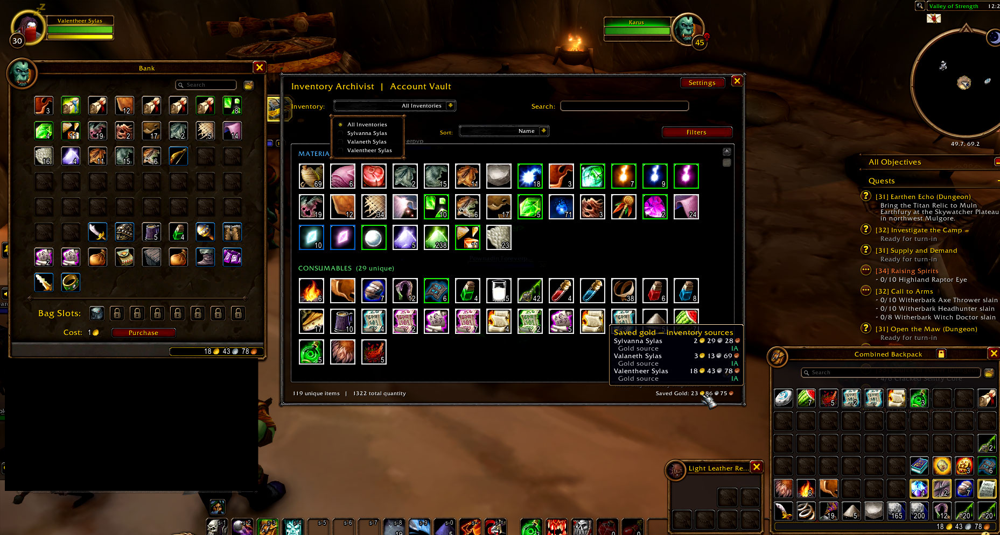

Inventory Archivist — Forever
Version: 0.1.2j Alpha  
Game client: WoW Forever 1.60.1 (Interface 16001)  
Status: Community alpha — feedback welcome
Inventory Archivist is a community-made addon for WoW Forever that remembers inventory snapshots across your characters, lets you browse them in a searchable Account Vault, adds optional item markers, and allows you to customize where your bags appear on screen.
The addon is read-only with respect to your items: it does not move, sell, delete, or otherwise modify inventory items. Inventory records and preferences are saved locally on your computer.
## Screenshots

### Account Vault Overview
Browse categorized inventory across multiple characters, including saved gold and bank information.



### Cross-Character Item Tracking
See how many of an item you own and which characters are holding it.


### Individual Character Inventory
Select a character to view their inventory and see where items are stored.


### Custom Bag Positioning — Combined Bags
Move and save your combined backpack, keyring, and reagent bag positions.


### Custom Bag Positioning — Separate Bags
Arrange individual bags independently and save their positions.


Installation
Download the ZIP attached to the latest GitHub Release (rather than GitHub's automatically generated source-code ZIP).
Exit World of Warcraft.
Extract the ZIP into your WoW Forever `Interface/AddOns/` directory.
Check that the folder structure looks like this:
```text
   Interface/
   └── AddOns/
       └── InventoryArchivist_Forever/
           ├── InventoryArchivist_Forever.toc
           ├── Core.lua
           └── ...other addon files
   ```
Launch WoW Forever and make sure Inventory Archivist - Forever is enabled on the addon list.
Enter `/ia` in chat to open the Account Vault.
Updating: Replace the addon folder with the newer release. Your saved settings and inventory records normally remain intact because WoW stores them separately in `WTF/SavedVariables`. Back up that data before major alpha updates.
Quick start
Log into a character and open your bags. Inventory Archivist records the items it can access.
Visit your bank and open it to let the addon record bank contents.
Type `/ia` to browse your recorded items. Use the Inventory dropdown to view all recorded inventories or a particular character/location.
Search for an item by name or item ID, use Filters to show or hide categories, or sort by Name or Quantity.
Click Settings in the Vault (or type `/ia settings`) to configure markers, Vault shortcuts, and bag positioning.
Important: The Vault shows saved snapshots, not live access to every character's inventory. To refresh another character's data, log into that character. Bank contents require opening the bank to refresh them.
Features and how to use them
Account Vault
The Vault brings recorded inventories together in a single window. It includes:
Inventory dropdown: Choose All Inventories or narrow the view to an available inventory/character scope.
Search: Find recorded items by name or item ID.
Filters: Toggle Materials, Consumables, Equipment, Other, and Junk categories; optionally hide quest items. Show All clears the active category filters.
Sort: Sort displayed items by Name or Quantity.
Item details: Hover over an item for its tooltip and recorded ownership/quantity information. Shift-clicking an item can insert its link into chat when supported by the client.
Saved Gold: Displays recorded character gold information; it is based on snapshots, not a live account balance.
The Vault is a browser only: you cannot transfer items between characters from this window.
Bag and bank markers (optional)
Enable Inventory Markers in Settings to display small advisory labels on supported bag and bank slots:
J — gray-quality (junk) item.
M — item classified as a material.
These labels are informational. They do not sell items, and ordinary equipment is not automatically marked as junk. Marker classification is experimental in this alpha.
Vault shortcut buttons
Settings has separate toggles for showing a Vault shortcut on bag windows and at the bank. These buttons open the Account Vault without needing to type `/ia`.
Custom bag positioning
On a fresh installation, custom positioning is enabled, positions are locked, and the lock control is always visible. Bags begin in their normal game positions until you customize them.
To move bags:
Open your bags and click the padlock on the bag title bar to unlock positioning.
Drag a bag using its small `::` grip to the location you prefer.
Click the padlock again to lock the layout.
Your customized positions are saved and should persist across `/reload` and subsequent logins.
Combined bags and separate bags have independent saved layouts. Settings also offers Reset Combined Position and Reset Separate Positions, so you can return either layout to native positioning without resetting the other.
If you prefer fewer controls, enable Show lock only on title-bar hover in Settings. You can also disable custom positioning entirely.
Chat commands
Command	Action
`/ia`	Open or close the Account Vault
`/iaforever`	Alternate command for the Vault
`/ia settings`	Open or close Settings
`/ia status`	Show realm information and number of recorded characters
`/ia scan`	Rescan accessible inventory (open the bank first to include bank data)
`/ia markers`	Toggle inventory markers
`/iabaglayout` is a diagnostic command for troubleshooting bag layout behavior; most players will not need it.
Data, realms, and privacy
Records are kept locally in WoW SavedVariables (`InventoryArchivistForeverDB`). The addon does not upload inventory data to an external service.
Characters and their snapshots are separated by realm, including Forever's PvE and PvP realms.
Removing the addon folder does not necessarily erase its saved data. WoW keeps SavedVariables separately in its `WTF` directory.
To test a fresh installation, fully exit the game and back up/rename the relevant Inventory Archivist SavedVariables files before relaunching. Doing so temporarily resets all saved snapshots and settings, not only bag positions.
Alpha limitations and feedback
This is a community testing release, so unusual client/UI interactions may still occur. One known minor visual quirk: when dragging a bag that has another bag natively stacked against it, the attached bag may briefly follow and then snap back. Saved coordinates normally remain correct.
If you find a problem, please open a GitHub Issue (if enabled) or report it to the addon author with:
What happened and what you expected.
Steps to reproduce it.
Any Lua error text and relevant screenshots.
Whether `/reload` changes the behavior.
Whether you were using combined or separate bags, and which realm you were on, if relevant.
Especially helpful tests: keyring/reagent bag positioning, combined/separate layout resets, bank markers, and inventory separation between realms.
License and acknowledgments
Inventory Archivist's original source code is released under the MIT License; see the `LICENSE` file included with the public release. The addon uses WoW's built-in interface APIs and textures, which are not relicensed under MIT.
This is an independent community project and is not affiliated with or endorsed by Blizzard Entertainment or the WoW Forever team.
